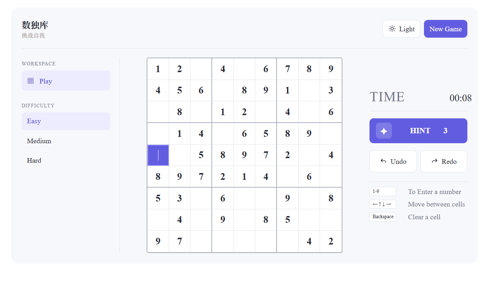

**Sudoku**

A simple, interactive game built with **html, CSS,and JavaScript**.

This project brings a classic puzzle to the browser. Player can select a difficulty
level to start, track their time, and use built-in tools to help complete each puzzle.

**Features**
- Hint: Get assistance when needed. 
- Timer: Track how long it take to solve a puzzle.
- Theme toggle: Switch between light and dark themes. 
- Undo/Redo: Reverse or restore previous move. 
- New Game: Start a new puzzle whenever player is ready. 

**Getting Started**
NO build tools or package installation are required. 

1. Clone the repo:
   
   git clone https://github.com/shilicao/Sudoku.git
    
2. Open the folder:

   cd Sudoku
    
3. Open index.html in local browser or use VS Code with Live Server extension. 
    
